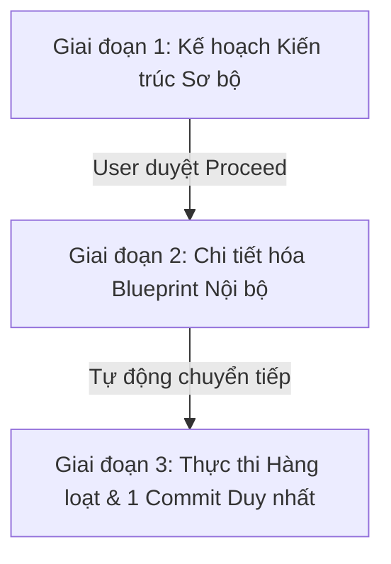

# Project Rules & Customizations

> **Nguồn quy tắc duy nhất (Single Source of Truth) cho mọi AI agent làm việc trên repo này** — Claude Code, Google Antigravity, hoặc bất kỳ agent nào khác. Không tạo bản sao của tệp này.

---

## PHẦN I: BẢN ĐỒ SỞ HỮU & TÀI LIỆU THIẾT KẾ (OWNERSHIP & DOCS)

### 1. Module Ownership Map
Mỗi tệp mã nguồn thuộc về **đúng một** module, và mỗi module có **đúng một** tài liệu thiết kế chính thức:

| Module | Tệp mã nguồn thuộc module | Tài liệu thiết kế |
|---|---|---|
| **Platform Shell** | `src/App.tsx`, `src/components/Dashboard.tsx`, `src/components/LoginPage.tsx`, `src/components/UserManagement.tsx`, `src/context/AuthContext.tsx`, `src/main.tsx` | [`DESIGN_PLATFORM_SHELL.md`](DESIGN_PLATFORM_SHELL.md) |
| **Process Designer** | `src/components/ProcessEditor.tsx`, `src/components/ProcessReader.tsx`, `src/components/BpmnModelerComponent.tsx`, `src/components/BpmnViewerComponent.tsx`, `src/components/BPMNGuide.tsx`, `src/utils/bpmnXmlGenerator.ts`, `src/utils/layout/*`, `src/bpmn-custom.d.ts` | [`DESIGN_PROCESS_DESIGNER.md`](DESIGN_PROCESS_DESIGNER.md) |
| **Form Designer** | `src/components/FormBuilder.tsx`, `src/components/print/PrintBlankForm.tsx` | [`DESIGN_FORM_DESIGNER.md`](DESIGN_FORM_DESIGNER.md) |
| **Form Operations** | `src/components/FormFiller.tsx`, `src/components/FormManager.tsx`, `src/components/SubmissionManager.tsx`, `src/components/print/PrintFilledForm.tsx`, `src/utils/formUtils.ts` | [`DESIGN_FORM_OPERATIONS.md`](DESIGN_FORM_OPERATIONS.md) |
| **Report Builder** | `src/components/ReportBuilder.tsx`, `src/components/FormReport.tsx`, `src/components/print/PrintReport.tsx`, `src/components/print/PrintScoring.tsx`, `src/components/report/*`, `src/utils/report*` | [`DESIGN_REPORT_BUILDER.md`](DESIGN_REPORT_BUILDER.md) |
| **Form Translator** | `scripts/formTranslator/*` | [`DESIGN_TRANSLATOR.md`](DESIGN_TRANSLATOR.md) |
| **Backend & Persistence** | `server.cjs`, `api/index.js` | [`DESIGN_BACKEND.md`](DESIGN_BACKEND.md) |
| **Design System** | `src/index.css`, `src/print.css`, `src/App.css` | [`DESIGN_UI_UX.md`](DESIGN_UI_UX.md) |

#### Shared types (`src/types.ts`)
Mỗi interface dùng chung có **đúng một** tài liệu chủ:
- `Process`, `ProcessStep`, `SOPSignOff`, `SOPSignOffs`, `FormField`, `FormDesignerField`, `RadioOption` ➔ [`DESIGN_PROCESS_DESIGNER.md`](DESIGN_PROCESS_DESIGNER.md)
- `FormTemplateISO`, `LayoutBlockISO`, `FormFieldISO`, `FormRevisionEntry`, `MatrixConfigISO`, `TableColumnConfig`, `TableRowConfig`, `SubtableColumn`, `ColumnSummaryRowConfig`, `TitleFormatISO`, `LinkedWorkStepInfo` ➔ [`DESIGN_FORM_DESIGNER.md`](DESIGN_FORM_DESIGNER.md)
- `Submission`, `SubmissionFieldSnapshot` ➔ [`DESIGN_FORM_OPERATIONS.md`](DESIGN_FORM_OPERATIONS.md)
- `ReportTemplateISO`, `ReportBlockConfig`, `ReportBlockType`, `ReportRevisionEntry`, `ReportDataModel`, `FieldEvaluationResult`, `ReportFieldRuleOverride` ➔ [`DESIGN_REPORT_BUILDER.md`](DESIGN_REPORT_BUILDER.md)
*(Lưu ý: User, Role, Permissions Matrix nằm trong `AuthContext.tsx` và thuộc `DESIGN_PLATFORM_SHELL.md`)*

### 2. Kỷ luật Tài liệu Thiết kế (Documentation Discipline)
- **Đọc trước khi sửa (Read Before Edit):** Trước khi can thiệp vào file mã nguồn, BẮT BUỘC đọc tài liệu thiết kế của module đó trước. Chỉ đọc symbol liên quan, không đọc cả file. Nếu tài liệu mâu thuẫn mã nguồn: mã nguồn là đúng, cập nhật tài liệu ngay.
- **Cập nhật sau khi sửa (Update After Edit):** Bắt buộc cập nhật tài liệu thiết kế trong cùng commit:
  1. *Cập nhật nội dung:* Data model, interface contracts, flow, technical debt bị ảnh hưởng.
  2. *Header Block `Verified At Commit`:* Ghi rõ ngày và tên các mục đã kiểm chứng thực tế:
     `| **Verified At Commit** | (2026-09-18) — FormBuilderProps linkedWorkSteps & UI hint verified against source |`
  3. *Change Log:* Chỉ ghi thay đổi kiến trúc/schema/invariant (tối đa ~15 dòng, xóa dòng cũ khi vượt, không ghi SHA commit, không ghi UI cosmetic).
- **Cấm ghi số dòng (No Line Numbers):** Tuyệt đối không ghi số dòng (`line 45-60`) vào tài liệu vì sẽ lệch khi commit. Luôn tham chiếu bằng tên symbol (`interface FormBuilderProps`, `function extractLinkedWorkSteps`).

---

## PHẦN II: TIÊU CHUẨN GIAO DIỆN & KIẾN TRÚC MÃ NGUỒN (UI/UX & CODE QUALITY)

### 3. Tuân thủ Master Design (UI/UX Compliance)
- **Triết lý Thiết kế Tối giản (Subtraction Design Mantra):** "Mọi phần tử xuất hiện trên màn hình bắt buộc phải có một mục đích cụ thể và thiết yếu. Nếu có thể lược bỏ hoặc gộp lại mà không làm mất tính năng, hãy lược bỏ." Mọi phần tử không trực tiếp phục vụ một quyết định hoặc hành động cụ thể của người dùng đều bị coi là nhiễu thị giác cần phải cắt tỉa.
- **4 Tiêu chuẩn Thiết kế Tối giản (Minimalist Criteria):**
  1. *Loại bỏ triệt để yếu tố trang trí thừa:* Không dùng hiệu ứng gradient màu mè, đổ bóng rườm rà, icon vô nghĩa không mang giá trị điều hướng, không lặp lại huy hiệu (badges) không cần thiết.
  2. *Tỷ lệ Tín hiệu trên Nhiễu cao (High Signal-to-Noise Ratio):* Ưu tiên khoảng trắng (whitespace) thoáng đãng để dẫn dắt tầm mắt; phân cấp thị giác bằng kích thước và độ đậm của kiểu chữ (typography hierarchy) và độ tương phản tự nhiên, không dùng màu sắc lòe loẹt.
  3. *Gộp và Tối giản hóa:* Tận dụng placeholder, inline feedback, và trạng thái tương tác tự nhiên thay vì tạo thêm các khối giao diện phụ trợ hay văn bản giải thích dài dòng.
  4. *Quy tắc Cấm rác UI (Zero UI Garbage Blacklist):* Tuyệt đối cấm các câu chữ hướng dẫn thao tác thừa thãi ("Bấm vào đây để...", "Nhấp..."), tooltip hành vi rườm rà (`title="Nhấp để..."`), và icon chỉ báo tự chế vô nghĩa.
- **CSS Tokens & Utility Classes:** Bắt buộc dùng CSS variables (`var(--primary)`, `var(--neutral-bg)`, …) và utility class (`.paper-card`, `.btn`) trong `src/index.css`. CẤM hardcode inline mã màu (ví dụ `#10a3a3`).
- **Nghiêm cấm `window.confirm()` / `alert()`:** Mọi xác nhận BẮT BUỘC dùng component dùng chung `ConfirmModal` (`src/components/common/ConfirmModal.tsx`).
- **Chuyển đổi lũy tiến (Progressive Adoption):** Khi sửa một component có `window.confirm()` cũ, bắt buộc chuyển toàn bộ sang `ConfirmModal`.
- **Lan truyền đồng bộ (Propagation):** Đổi cấu trúc HTML/class chuẩn phải cập nhật đồng bộ các component tương tự. Thêm CSS token mới phải ghi nhận vào `DESIGN_UI_UX.md`.

### 4. Tiêu chuẩn Kiến trúc & Chất lượng Mã nguồn (Architecture Invariants)
- **4.1 Tách biệt Logic Thuần túy (Pure Utility Extraction — Rule 13.8):** Mọi logic tính toán, mảng (sort, filter, reorder), format, hoặc chuẩn hóa schema KHÔNG phụ thuộc React state/JSX BẮT BUỘC phải tách thành pure function trong module utility (`src/utils/formUtils.ts`, `src/utils/bpmnXmlGenerator.ts`), có types đầy đủ. Component monolith chỉ đảm nhận hiển thị và event delegation.
- **4.2 Triệt tiêu Mã chết (Dead-Code Pruning — Rule 13.7):** Khi nâng cấp hoặc thay thế tính năng, BẮT BUỘC rà soát toàn bộ call-sites và xóa sạch hàm cũ, state cũ, props, hoặc biến không dùng (`TS6133`) trong cùng 1 commit. Cấm để lại orphaned code.
- **4.3 Kiểm soát Phình to Monolith (Monolith Guard — Rule 13.9):** Với các file monolith lớn (>3.000 dòng, đặc biệt `FormBuilder.tsx`), khi thêm phân hệ khép kín mới (modal lớn, inspector panel độc lập) có khối lượng dự kiến >150 dòng JSX, BẮT BUỘC tách sub-component riêng (`src/components/form/`). Không tự ý refactor diện rộng ngoài phạm vi task để đảm bảo zero regression.
- **4.4 Triệt tiêu Biến Destructure (Destructuring Prune — Rule 13.10):** Khi xóa một thuộc tính hoặc biến không còn sử dụng, BẮT BUỘC xóa ngay tên biến đó tại vị trí destructuring (`const { varA, varB } = ...`) và tại hàm trả về (`return { varA }`) trong cùng 1 lần patch để tránh kích hoạt lỗi `TS6133: declared but its value is never read` (do cờ `noUnusedLocals: true`) làm đứt gãy `npm run build`.

### 5. Quy tắc An toàn khi Sửa mã (Safe Patching Invariants)
- **5.1 Đọc trước khi viết replacement (Rule 12.1):** Luôn `view_file` đúng vùng cần sửa và copy chính xác whitespace/indentation. CẤM viết `TargetContent` từ trí nhớ.
- **5.2 Ưu tiên `replace_file_content` gốc (Rule 12.2):** Chỉ dùng Python script khi target string trùng lặp nhiều nơi hoặc cần regex. Khi dùng Python, ưu tiên `content.replace(exact_old, exact_new, 1)`, cấm index slicing.
- **5.3 Giới hạn Chunk Patch < 50 dòng (Rule 12.6):** Trên file monolith lớn (>2.000 dòng), mỗi lần thay thế KHÔNG ĐƯỢC VƯỢT QUÁ 50 dòng code, luôn bao gồm tối thiểu 3 dòng context độc nhất trước và sau.
- **5.4 Kiểm tra TypeScript tức thì sau mỗi file (Rule 12.3):** Sau khi sửa xong mỗi file `.ts`/`.tsx`, BẮT BUỘC chạy ngay `npx tsc --noEmit`. Lỗi phát sinh phải sửa dứt điểm ngay tại file đó trước khi sang file tiếp theo.
- **5.5 Không chạy Python inline chứa JSX (Rule 12.4):** Khi script chứa `()`, `=>`, `{}`, `<>`, cấm chạy `python -c "..."` trên PowerShell. Bắt buộc lưu ra file `.py` tạm rồi thực thi.

---

## PHẦN III: QUY TRÌNH 2 GIAI ĐOẠN & ATOMIC SINGLE COMMIT (WORKFLOW)

### 6. Quy trình Lập Kế hoạch & Thực thi 2 Giai đoạn (Two-Stage Planning)



#### Giai đoạn 1: Kế hoạch Kiến trúc Sơ bộ (Trước khi nhận `Proceed`)
- **Mục tiêu:** Cung cấp bức tranh tổng quan để Người dùng (The Thinker) duyệt nhanh định hướng kiến trúc & thẩm định phản biện giao diện.
- **Nội dung `implementation_plan.md`:**
  - Tóm tắt vấn đề & Nguyên nhân gốc (Root Cause).
  - Danh sách file ảnh hưởng (`[MODIFY]`, `[NEW]`, `[DELETE]`).
  - Hướng tiếp cận logic, breaking change, schema impact.
  - **Phản biện UI/UX & ASCII Wireframe (BẮT BUỘC khi có thêm mới/chỉnh sửa UI):**
    1. *Bảng Thẩm định Phản biện Phần tử UI (Bộ 3 câu hỏi chất vấn cốt tử: Purpose & Essentiality, Chống Over-engineering, Natural Affordance):*
       | Phần tử UI | Mục đích sử dụng thực tế | Điểm thiết yếu (/10) | Quyết định phản biện |
       |---|---|---|---|
       | Tên khối/nút/trường | Người dùng dùng để làm gì? | 1 - 10 | Giữ lại / Loại bỏ / Gộp vào [X] |
       *(Mọi phần tử có Điểm thiết yếu < 7/10 BẮT BUỘC đưa vào diện loại bỏ hoặc gộp).*
    2. *ASCII Wireframe Đối chiếu Trực quan 2 Phiên bản:* Thay thế hoàn toàn mockup UI bằng ASCII Wireframe 2 phiên bản (Bản Hiện tại vs. Bản Dự kiến Chỉnh sửa / Before vs. After) tuân thủ 4 Tiêu chuẩn Thiết kế Tối giản.
  - Kế hoạch kiểm chứng (Verification Plan).
- **RÀNG BUỘC CỨNG (NEVER):** **TUYỆT ĐỐI CẤM viết các đoạn code thay thế dài dòng** ở giai đoạn này để tránh kéo dài thời gian review và gây nhiễu định hướng.
- **Hành động:** Đặt `RequestFeedback: true` và dừng lại chờ Người dùng bấm `Proceed`.

#### Giai đoạn 2: Chi tiết hóa Blueprint Nội bộ (Ngay sau khi nhận `Proceed`)
- **Mục tiêu:** Chuẩn bị sẵn sàng 100% code blocks, rà soát dead-code và unused variables trước khi chạm vào mã nguồn thực tế.
- **Hành động bắt buộc (TUYỆT ĐỐI KHÔNG sửa code ngay):**
  1. Đọc `SESSION_LOG.md` (mục Bài học Tích lũy) đối chiếu các file cần sửa.
  2. Đọc chính xác các vùng mã nguồn thực tế bằng `view_file`.
  3. Soạn Exact Code Blocks hoàn chỉnh (import, hook, logic, JSX).
  4. Cập nhật blueprint vào `implementation_plan.md` với **`RequestFeedback: false`**.
- **Chuyển tiếp tự động:** Ngay sau khi lưu blueprint, tự động chuyển thẳng sang Giai đoạn 3 mà **KHÔNG dừng lại hỏi Người dùng lần 2** (trừ trường hợp phát sinh breaking change ngoài dự kiến).

#### Giai đoạn 3: Thực thi Hàng loạt một lượt (Batch Execution)
1. Chỉnh sửa tuần tự các file mã nguồn theo đúng blueprint (tuân thủ Rule Chunk < 50 dòng).
2. Chạy `npx tsc --noEmit` sau mỗi file; chạy `npm run build` ở bước cuối xác nhận Vite bundle pass 100%.
3. Cập nhật tài liệu thiết kế module tương ứng (`DESIGN_*.md`).
4. Cập nhật `SESSION_LOG.md` (khi và chỉ khi gặp bẫy/lỗi kỹ thuật mới): Bổ sung giải pháp phòng ngừa vào ## Bài học Tích lũy (nếu phiên suôn sẻ không có lỗi mới, KHÔNG chạm vào file này). Triệt tiêu việc ghi nhật ký phiên thủ công (vai trò này do git log và Conventional Commits đảm nhận).
5. Chạy đúng **1 lần commit & push nguyên tử duy nhất** theo Mục 7 (khi hoàn tất sprint bàn giao).
6. **BƯỚC CUỐI CÙNG (Chỉ dẫn Nghiệm thu):** Tự động kiểm tra môi trường và thông báo cho Người dùng nên kiểm tra trên Local hay Online theo quy chuẩn Mục 8.

### 7. Quy trình Native Git Push Chuẩn (Guarded Atomic Single Commit)
- **Ràng buộc bất biến:** Toàn bộ Code + Tài liệu thiết kế + `SESSION_LOG.md` PHẢI được gộp vào **ĐÚNG 1 COMMIT DUY NHẤT**. Tuyệt đối CẤM tạo commit thứ hai sau khi push để triệt tiêu việc kích hoạt deploy dư thừa trên Vercel / CI.
- **Tiêu chuẩn Commit Message (Conventional Commits):** Bắt buộc tuân thủ cấu trúc `<type>(<scope>): <summary>`:
  - *Types:* `feat`, `fix`, `perf`, `refactor`, `docs`, `chore`.
  - *Scopes:* tên module hoặc tính năng (`form-designer`, `form-filler`, `form-table`, `dashboard`, `ui-ux`, `backend`, ...).
  - *Summary:* mô tả ngắn gọn, động từ chỉ hành động rõ nghĩa (ví dụ: `feat(form-table): synchronize table guidance styling`).
- **Vệ sinh tiến trình nền & Lock (Process Hygiene — Bắt buộc):** Trên Windows, các tiến trình `git.exe` chạy ngầm có thể giữ file lock khiến `git status` hoặc `git commit` bị treo vĩnh viễn. Bắt buộc dọn dẹp bằng `Stop-Process` trước khi chạy lệnh git.
- **Rà soát file trước khi Stage:** Luôn quan sát `git status --short` để đảm bảo không lọt file tạm, file debug (`.py`, `.tmp`, dump data) vào staging.
- **Lệnh thực thi Guarded duy nhất trong PowerShell** (`WaitMsBeforeAsync: 25000` ms) kiểm soát `$LASTEXITCODE` và đồng bộ an toàn:
  ```powershell
  Stop-Process -Name git -Force -ErrorAction SilentlyContinue; Remove-Item -Path .git\index.lock -Force -ErrorAction SilentlyContinue; git add -A; if ($LASTEXITCODE -eq 0) { git commit -m "<type>(<scope>): <summary>"; if ($LASTEXITCODE -eq 0) { git pull --rebase origin main; git push origin main; git log -n 1 --oneline } }
  ```

### 8. Quy Chuẩn Chỉ Dẫn Nghiệm Thu Cuối Phiên (End-of-Session Verification Protocol)
Vào cuối mỗi phản hồi/kết thúc phiên làm việc, Agent **BẮT BUỘC** thông báo rõ ràng cho Người dùng nên kiểm tra kết quả tại đâu (**Local** hay **Online**):

#### 8.1 Trường hợp Kiểm tra trên Local (Check Local)
- **Áp dụng khi:** Đang trong quá trình phát triển/tinh chỉnh, vừa sửa code chưa push, hoặc tính năng cần người dùng tương tác thử nghiệm trực tiếp trên máy trước khi bàn giao.
- **Tự động kiểm tra Local Server:**
  Agent chủ động chạy lệnh kiểm tra cổng dev server trong hệ thống (Vite port `3000`, Express API port `3001`):
  ```powershell
  Get-NetTCPConnection -LocalPort 3000, 3001 -State Listen -ErrorAction SilentlyContinue | Select-Object LocalPort, State
  ```
- **Quy chuẩn hiển thị Link (Bắt buộc dùng IP thay cho `localhost`):**
  Tuyệt đối không dùng chuỗi `localhost`. Bắt buộc hiển thị theo địa chỉ IP IPv4 (`http://127.0.0.1:3000` hoặc IP mạng nội bộ như `http://192.168.1.119:3000` nếu cần test từ thiết bị khác) để tránh lỗi phân giải IPv6 (`::1`) trên Windows.
- **Hành động phản hồi:**
  - *Nếu Server đang chạy:* Cung cấp ngay đường link trực tiếp (Clickable Markdown Link) theo định dạng IP (ví dụ: `http://127.0.0.1:3000`, `http://127.0.0.1:3000/forms/:id/fill`,...).
  - *Nếu Server chưa chạy:* Báo rõ "Server đang tắt" và cung cấp sẵn lệnh 1 chạm để người dùng khởi động: `npm run dev`, kèm link `http://127.0.0.1:3000`.

#### 8.2 Trường hợp Kiểm tra trên Môi trường Trực tuyến (Check Online)
- **Áp dụng khi:** Đã hoàn tất sprint, hoàn thành Atomic Single Commit & Push lên nhánh `main`, hoặc tính năng cần kiểm chứng thực tế trên domain production (Cloudflare R2 presigned URLs, Google OAuth redirect, kiểm thử đa thiết bị).
- **Hành động phản hồi:**
  - Cung cấp liên kết commit mới nhất: [GitHub Commits](https://github.com/duyarc/process-design/commits/main).
  - Cung cấp liên kết trực tiếp tới phiên bản online trên Vercel: [Process Design](https://process.wolver.vn/).
  - Định dạng thông báo mẫu chuẩn tối giản:
    ```markdown
    ### Nghiệm thu Online
    - Commit: [<hash> — <summary>](https://github.com/duyarc/process-design/commits/main)
    - Trải nghiệm trực tiếp: [Process Design](https://process.wolver.vn/) *(chờ Vercel build ~1–2 phút)*
    ```

---

## PHẦN IV: VÒNG LẶP HỌC HỎI & BỘ NHỚ PHIÊN (CONTINUOUS IMPROVEMENT)

### 9. Vòng lặp Tự học Tối giản (Lean Episodic Memory)
Bộ nhớ phiên duy nhất là [`SESSION_LOG.md`](SESSION_LOG.md) tại repo root, tuân thủ triệt để nguyên tắc Subtraction. File này **CHỈ đóng vai trò lưu trữ danh sách Bài học Tích lũy (Negative Constraints)**, bãi bỏ hoàn toàn các bảng thống kê KPI và nhật ký phiên thủ công:
- **Lưu vết lịch sử công việc:** Do `git log` đảm nhận tự động 100% qua Conventional Commits.
- **Lưu vết kiến trúc & hợp đồng dữ liệu:** Do `DESIGN_*.md` (mục Change Log) đảm nhận.
- **Trước khi làm (Giai đoạn 2):** Bắt buộc đọc `## Bài học Tích lũy` trong `SESSION_LOG.md` để nhận diện cạm bẫy kỹ thuật đã từng gặp và phòng ngừa tái diễn.
- **Trước khi push (Giai đoạn 3):**
  1. *Phân tích & ghi nhận bẫy mới (nếu có):* Nếu phiên làm việc gặp lỗi hoặc bẫy kỹ thuật mới, phân loại theo nhóm (`LOGIC`, `SCOPE`, `UI`, `BLOAT`, `ENV`) và thêm ngay giải pháp vào bảng `## Bài học Tích lũy` (duy trì tối đa ~20-25 bài học thực chiến nhất). Nếu phiên suôn sẻ không có lỗi mới, KHÔNG chỉnh sửa file này.
  2. *Quy tắc tiến hóa (Rule Evolution):* Khi cùng 1 cạm bẫy lặp lại **≥ 2 lần**, BẮT BUỘC luật hóa thành quy tắc cố định trong `AGENTS.md` và loại bỏ khỏi bảng bài học để tránh trùng lặp.

### 10. Master Index (`README.md`)
Agent PHẢI cập nhật [`README.md`](README.md) nếu: thêm module chức năng mới, thay đổi Tech Stack lõi, hoặc thay đổi quy trình khởi chạy hệ thống.
